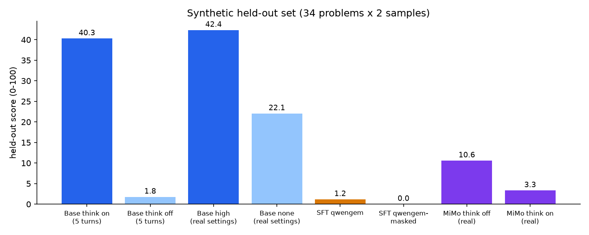
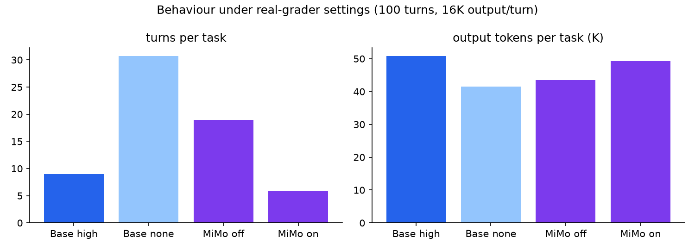
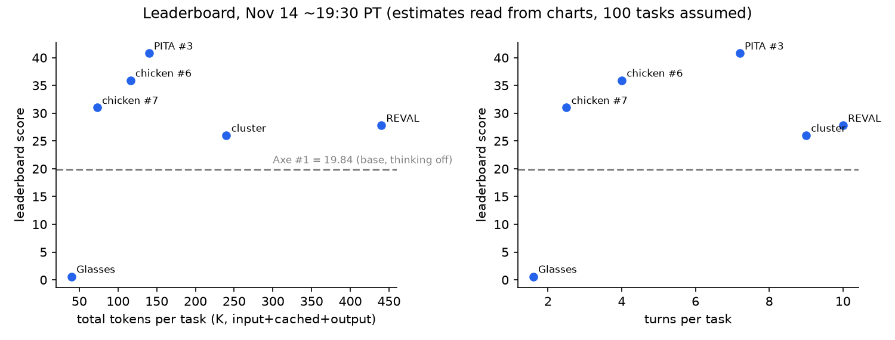

# 1. Summary

- **Leaderboard:** our best submission is **19.84** (Axe #1: base Qwen3.5-9B, thinking off, Tinker default sampling), 10th of 11. The leader is 40.79.
- **Local evidence:** **thinking on beats thinking off by about 2×** under the real grader's settings (42.4 vs 22.1 on our synthetic held-out set), with about a third of the turns. A base submission with thinking on has not been tested on the leaderboard yet.
- **SFT on Gemini reference solutions made the model worse** (1.2 and 0.0 vs base 40.3). The model learned the format but stopped reasoning.
- **MiMo-V2.6-Distill (Xiaomi, open weights) is a poor teacher for this task.** It scored 3–11 locally against the base model's 42. It rarely submits.
- **The leaders use few turns** (about 2.5–7 per task, assuming 100 tasks) and moderate token budgets. Long tool loops correlate with lower scores.
- **Recommended next step:** self-distill the base model on its own short, successful thinking traces (expert iteration), using the real-grader settings. Generate on Modal and train on Tinker.

# 2. Setup

| Item | Value |
|---|---|
| Base model | `Qwen/Qwen3.5-9B` on Tinker (LoRA rank 32), 64K context |
| Real grader | `github.com/vals-ai/hackathon-post-training-agent` (made public Nov 14 evening) |
| Grader tools | `cpp_executor(cpp_code, stdin)`, `submission(cpp_code)`; last compiling submission is graded |
| Grader limits | 100 turns, 50 submissions, per-turn output cap 16,384 (settable); context overflow drops the oldest turns |
| Compile | `g++ -std=c++20 -O2 -pipe` (no auto-included `bits/stdc++.h`) |
| Local harness | `post-train/harness/` (branch `lenz-sft`), now mirroring the real tools, prompt, flags and limits |
| Sandbox | Modal (`gcc:14`, static binaries in a chroot jail, wall-clock timing) or local Docker |
| Eval set | Synthetic held-out set: 34 Gemini-written Vals-style problems, small (40 pts) and large (60 pts) hidden tests. **Not the real benchmark**: absolute scores do not transfer, relative comparisons and behaviour do. |
| Training pools | 86 synthetic (non-held-out) problems with strong large tests; 642 CodeContests problems (public), whose "large" tests are tiny (90% under ~430 B) and do not test efficiency |

Scores below are 40/60 all-or-nothing per half unless noted. "Partial credit" means a fraction of tests passed, which matches the real prompt.

# 3. Results

## R1: thinking on vs off at 5 turns (local, measured)
68 episodes per arm (34 held-out × 2), 32K output per turn, 64K context, temperature 0.6.
Thinking on scored **40.3 ± 5.9**; thinking off scored **1.8 ± 1.0**. Without thinking, the model hit the 5-turn limit in 56 of 68 episodes.

## R2: base model at real-grader settings (local, measured)
100 turns and 16K output per turn, otherwise the same as R1.

| | Score (40/60) | Partial credit | Full solves | Turns/task | Output tokens/task | Min/task |
|---|---|---|---|---|---|---|
| Thinking **high** | **42.4** | **44.0 ± 5.8** | 28/68 | 9.0 | ~51K | 10.8 |
| Thinking **none** | 22.1 | 26.0 ± 4.5 | 11/68 | 30.8 | ~42K | 10.6 |

About half of all episodes still exhausted our 64K context. Our harness stops the episode at that point, while the real grader drops old turns instead.

## R3: SFT on Gemini reference solutions (local, measured)
- **Data:** 81 training problems, each converted into a 2-turn trace: short notes, `submit(fast_cpp)`, the tool result, then `EXIT`.
- **`qwengem`:** 3 epochs.
- **`qwengemmasked`:** the hint is masked 30% → 60% → 90%, then dropped (4 epochs).

`qwengem` scored **1.2** and `qwengemmasked` **0.0**, against base **40.3** (5-turn eval).
The models learned the format, staying short and submitting, but not the skill. The training traces contain almost no reasoning and no examples of recovering from failure. Gemini is not open-source, so this method is a grey area under the rules regardless.

## R4: MiMo-V2.6-Distill-Qwen-9B as a teacher (local, measured)
MiMo was served with vLLM on Modal H100s.

- **5 turns, with teacher-only turn reminders:** **4.2** (1/24 full solves, 5/24 submitted).
- **Real settings, thinking off:** **10.6** (n ≈ 50); **thinking on:** **3.3** (n = 60).

Base Qwen scored 42.4 under the same settings. MiMo either runs long test-and-fix loops without submitting, or thinks until its output budget runs out. Distilling it would make our model worse, so it was dropped.

## R5: leaderboard analysis (estimate, read from the Vals charts, 100 tasks assumed)

| Submission | Score | Tokens/task | Turns/task | Time/task |
|---|---|---|---|---|
| PITA #3 | 40.8 | ~140K | ~7 | 21 min |
| chicken tenderloins #6 | 35.9 | ~116K | ~4 | 8 min |
| chicken tenderloins #7 | ~31 | ~73K | ~2.5 | — |
| 20–30 cluster | 20–30 | 180–300K | 7.5–10.5 | 5–30 min |
| Axe #1 (ours) | 19.84 | — | likely 20–30 | 14 min |

Total tokens are mostly re-sent input, so the leaders run a few calls with moderate output: think, submit, `EXIT`. Teams spending more than ~8 turns or ~180K tokens per task all score in the 20s.

# 4. Infrastructure findings that changed results
- **The real grader does not auto-include `bits/stdc++.h`.** Solutions missing headers fail to compile. Our old harness hid this.
- **Sandbox reward hack, fixed.** Programs could read the hidden expected outputs. Programs are now statically linked and chrooted.
- **Modal's gVisor reports bogus CPU time** (about 2.5 s for a trivial program), so Modal judges wall time. Sample tests are shipped inline.
- **Infrastructure errors had been scored as wrong answers.** They now raise errors and are retried.
- **The 5-turn limit was only Vals' endpoint smoke check.** Axe #2 failed it because it never produced an `EXIT`. Scoring allows 100 turns.

# 5. Next steps
1. **Submit base with thinking on:** temperature 0.6, top p 0.95, 16,384 output tokens, 100 turns. Optionally also try 32K output.
2. **Self-distillation, about one step of RL at Modal prices:**
   - Serve base Qwen3.5-9B on Modal.
   - Sample thinking-on episodes at real settings on training problems that have real large tests.
   - Keep solved episodes with ≤5 turns and no overflow, then SFT on Tinker.
   - Evaluate behaviour locally and score on the leaderboard.
3. **Task distribution:** the CodeContests tests do not check efficiency. We need more problems with real large tests: the synthetic set, or open-r1/codeforces train with its generated tests.
4. **Optional:** a short GRPO run with a turn bonus if Tinker credit remains.

# 6. Reproduction pointers
Code: `post-train/` on branch `lenz-sft` of `github.com/raavigupta-rd/vals-ai-hackathon-lora`.

| Step | Command (from `post-train/`) |
|---|---|
| Held-out eval | `HARNESS_BACKEND=modal uv run python -m harness.eval --problems data/synth_ioi/heldout.jsonl --samples 2 --renderer qwen3_5 --max-tokens 16384 --max-turns 100 --tag <tag>` |
| SFT (Gemini) | `scripts/sft_then_eval.sh qwengem --epochs 3` |
| MiMo server / traces | `uv run modal deploy -m harness.mimo_server`; `uv run python -m harness.mimo_traces ...` |
| Figures | `uv run --with matplotlib --no-project python docs/make_figures.py` |

Raw results are in `runs/<tag>/results.jsonl` and `data/mimo_traces/*.jsonl` (gitignored, local only).
